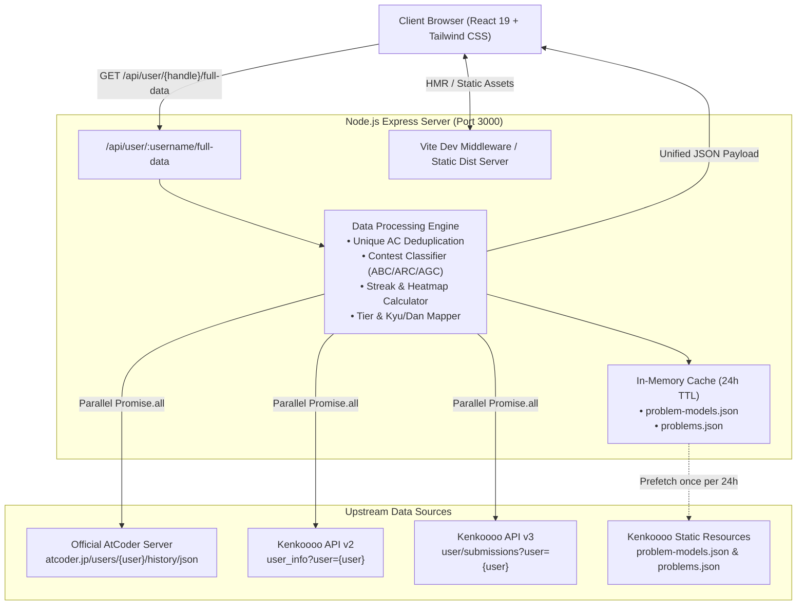
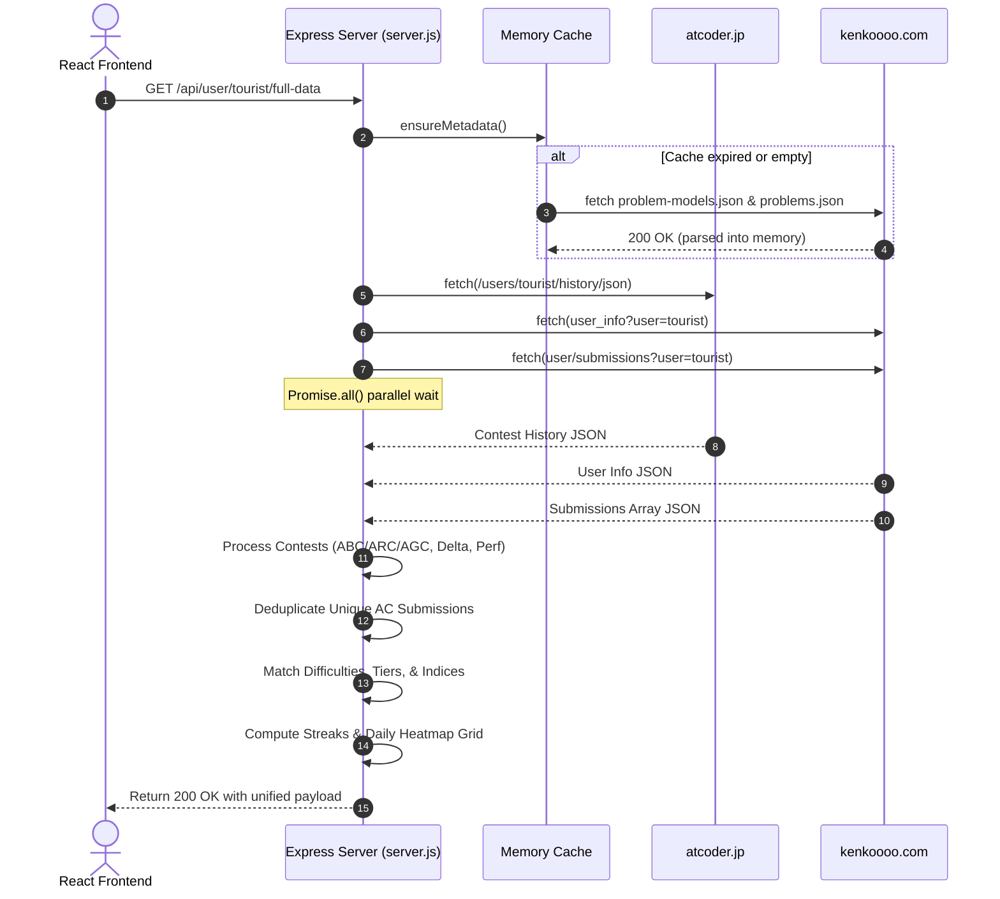
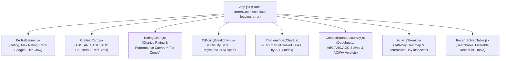

# 📘 The Complete Engineering Booklet: AtCoder Visualizer & Problem Tracker

> **A comprehensive deep-dive into the architecture, external API integration, data aggregation engine, and interactive frontend visualizations of the AtCoder Visualizer Dashboard.**

---

## 📑 Table of Contents

1. [Executive Summary & Motivation](#1-executive-summary--motivation)
2. [High-Level Architecture](#2-high-level-architecture)
3. [The Upstream Data Sources & APIs](#3-the-upstream-data-sources--apis)
   - [3.1 Official AtCoder History API](#31-official-atcoder-history-api)
   - [3.2 Kenkoooo AtCoder Problems APIs](#32-kenkoooo-atcoder-problems-apis)
   - [3.3 Upstream Endpoints Summary Table](#33-upstream-endpoints-summary-table)
   - [3.4 The CORS Challenge & Why a Backend Proxy is Mandatory](#34-the-cors-challenge--why-a-backend-proxy-is-mandatory)
4. [Backend Engineering & Data Processing (`server.js`)](#4-backend-engineering--data-processing-serverjs)
   - [4.1 Global In-Memory Metadata Caching](#41-global-in-memory-metadata-caching)
   - [4.2 The Full User Data Aggregation Pipeline](#42-the-full-user-data-aggregation-pipeline)
   - [4.3 Contest Categorization & Performance Analytics](#43-contest-categorization--performance-analytics)
   - [4.4 Rating Tiers, Kyu/Dan Ranks, and Codeforces Title Mapping](#44-rating-tiers-kyudan-ranks-and-codeforces-title-mapping)
   - [4.5 Submission De-duplication & Problem Breakdown](#45-submission-de-duplication--problem-breakdown)
   - [4.6 Activity Streak & Heatmap Computation](#46-activity-streak--heatmap-computation)
5. [Frontend Architecture & UI Components (`src/`)](#5-frontend-architecture--ui-components-src)
   - [5.1 Component Hierarchy & Data Flow](#51-component-hierarchy--data-flow)
   - [5.2 Profile Banner (`ProfileBanner.jsx`)](#52-profile-banner-profilebannerjsx)
   - [5.3 Contest Breakdown Card (`ContestCard.jsx`)](#53-contest-breakdown-card-contestcardjsx)
   - [5.4 Interactive Rating History Chart (`RatingChart.jsx`)](#54-interactive-rating-history-chart-ratingchartjsx)
   - [5.5 Problem Difficulty & Index Distribution (`DifficultyBreakdown.jsx` & `ProblemIndexChart.jsx`)](#55-problem-difficulty--index-distribution)
   - [5.6 Contest Source & Verdict Accuracy (`ContestSourceAccuracy.jsx`)](#56-contest-source--verdict-accuracy-contestsourceaccuracyjsx)
   - [5.7 Interactive Consistency Heatmap & Submission Inspector (`ActivityStreak.jsx`)](#57-interactive-consistency-heatmap--submission-inspector-activitystreakjsx)
   - [5.8 Recently Solved Problems Explorer (`RecentSolvedTable.jsx`)](#58-recently-solved-problems-explorer-recentsolvedtablejsx)
6. [Full-Stack Express + Vite Integration](#6-full-stack-express--vite-integration)
7. [Step-by-Step Developer Runbook](#7-step-by-step-developer-runbook)
8. [Production Deployment & Extension Ideas](#8-production-deployment--extension-ideas)

---

## 1. Executive Summary & Motivation

### The Problem
[AtCoder](https://atcoder.jp/) is one of the premier competitive programming platforms in the world, renowned for top-tier problem quality. However, unlike **Codeforces**, the native AtCoder user profile lacks granular problem-solving analytics:
- It **does not display total solved problem count** or unique AC counts directly on the user profile.
- It provides **no visual breakdown of solved tasks by difficulty rating** or problem index (A, B, C, D, E, F, G, Ex).
- It does not classify contest types (**ABC**, **ARC**, **AGC**, **AHC**) into discrete performance cards.
- It lacks an interactive **activity heatmap** and submission inspector.
- The official rating chart lacks direct overlay comparison between **Performance** and **Rating**.

### The Solution
The **AtCoder Visualizer & Problem Tracker** is a full-stack, single-page application built to bridge this gap. It aggregates official AtCoder contest history and Kenkoooo AtCoder Problems data into a cohesive, high-performance, dark-mode analytics suite inspired by the best features of Codeforces.

---

## 2. High-Level Architecture

The system uses a **BFF (Backend-for-Frontend)** architecture where a unified Node.js Express server acts as both the reverse proxy / data aggregation engine and the Vite application host.



---

## 3. The Upstream Data Sources & APIs

The application pulls from **two primary authorities**:
1. **Official AtCoder Server (`atcoder.jp`)** for official contest participation records and rating updates.
2. **Kenkoooo AtCoder Problems API (`kenkoooo.com`)** for submission logs, problem difficulty ratings, and global rankings.

### 3.1 Official AtCoder History API

- **Endpoint**: `https://atcoder.jp/users/{username}/history/json`
- **Method**: `GET`
- **Output**: Array of contest history objects.

#### Example Response:
```json
[
  {
    "IsRated": true,
    "Place": 1,
    "OldRating": 3824,
    "NewRating": 3855,
    "Performance": 4210,
    "InnerPerformance": 4210,
    "ContestScreenName": "agc065.contest.atcoder.jp",
    "EndTime": "2023-12-17T23:00:00+09:00",
    "ContestName": "AtCoder Grand Contest 065",
    "ContestNameEn": "AtCoder Grand Contest 065"
  }
]
```

#### Key Fields Handled:
- `IsRated` (`boolean`): If `false`, the contest was unrated for that user and is ignored for rating curve calculations.
- `Place` (`number`): Global rank in the contest.
- `OldRating` / `NewRating` (`number`): Rating before and after the contest.
- `Performance` (`number`): Performance rating achieved in that specific contest.
- `ContestScreenName` (`string`): Identifies contest category (starts with `abc`, `arc`, `agc`, `ahc`).

---

### 3.2 Kenkoooo AtCoder Problems APIs

The open-source [Kenkoooo AtCoder Problems](https://github.com/kenkoooo/AtCoderProblems) project crawls and calculates difficulty ratings for all AtCoder tasks. We utilize four distinct endpoints:

#### A. User Info API
- **Endpoint**: `https://kenkoooo.com/atcoder/atcoder-api/v2/user_info?user={username}`
- **Purpose**: Provides official global ranks and point sums.
- **Fields**:
  - `user_id`: Username handle
  - `accepted_count`: Total unique problems accepted
  - `accepted_count_rank`: Global rank by solved count
  - `rated_point_sum`: Total points earned in rated contests
  - `rated_point_sum_rank`: Global rank by rated point sum

#### B. Submissions API
- **Endpoint**: `https://kenkoooo.com/atcoder/atcoder-api/v3/user/submissions?user={username}&from_second=0`
- **Purpose**: Full chronological log of every submission the user ever submitted.
- **Fields per submission**:
  - `id`: Submission ID on AtCoder
  - `epoch_second`: Unix timestamp of the submission
  - `problem_id`: Unique identifier (e.g., `abc330_e`)
  - `contest_id`: Contest identifier (e.g., `abc330`)
  - `user_id`: Handle
  - `language`: Compiler string (e.g., `C++ 23 (gcc 12.2)`)
  - `point`: Points awarded
  - `length`: Source code byte length
  - `result`: Verdict (`AC`, `WA`, `TLE`, `MLE`, `RE`, `CE`)
  - `execution_time`: Execution time in milliseconds

#### C. Problem Models Resource
- **Endpoint**: `https://kenkoooo.com/atcoder/resources/problem-models.json`
- **Size**: ~3–5 MB JSON
- **Purpose**: Maps each `problem_id` to its statistical difficulty rating.
```json
{
  "abc330_e": {
    "slope": -0.0012,
    "intercept": 5.42,
    "variance": 0.12,
    "difficulty": 948,
    "discrimination": 0.003,
    "raw_difficulty": 948,
    "is_experimental": false
  }
}
```

#### D. Problem Details Resource
- **Endpoint**: `https://kenkoooo.com/atcoder/resources/problems.json`
- **Size**: ~4–6 MB JSON
- **Purpose**: Human-readable problem titles, contest associations, and problem indices (`A`, `B`, `C`, etc.).
```json
[
  {
    "id": "abc330_e",
    "contest_id": "abc330",
    "problem_index": "E",
    "name": "Mex and Update",
    "title": "E. Mex and Update"
  }
]
```

---

### 3.3 Upstream Endpoints Summary Table

| Authority | Endpoint URL | Size / Frequency | Role in App |
| :--- | :--- | :--- | :--- |
| **AtCoder** | `/users/{u}/history/json` | ~5–50 KB (per search) | Rating progression, performance curve, contest delta |
| **Kenkoooo** | `/v2/user_info?user={u}` | ~1 KB (per search) | Global accepted rank & rated point sum |
| **Kenkoooo** | `/v3/user/submissions?user={u}&from_second=0` | ~50 KB–5 MB (per search) | Solved tasks, language stats, heatmap, verdict breakdown |
| **Kenkoooo** | `/resources/problem-models.json` | ~4 MB (cached 24 hrs) | Assigns difficulty score & tier color to tasks |
| **Kenkoooo** | `/resources/problems.json` | ~5 MB (cached 24 hrs) | Assigns problem index (`A`..`Ex`) and readable title |

---

### 3.4 The CORS Challenge & Why a Backend Proxy is Mandatory

If a client-side single page app attempts to fetch `https://atcoder.jp/users/tourist/history/json` directly using `window.fetch()`, the browser will immediately terminate the request with a **Cross-Origin Resource Sharing (CORS) error**:

```
Access to fetch at 'https://atcoder.jp/users/tourist/history/json' from origin 'http://localhost:3000'
has been blocked by CORS policy: No 'Access-Control-Allow-Origin' header is present on the requested resource.
```

Furthermore, fetching the two massive catalog files (`problem-models.json` and `problems.json`, totaling nearly 10 MB) on every user search would destroy client performance and consume unnecessary bandwidth.

#### The Backend Proxy Solves Both:
1. **Bypasses CORS**: Server-to-server requests made by Node.js are not subject to browser CORS policies.
2. **Metadata Caching**: The server loads the ~10 MB problem catalogs once into memory, caching them for 24 hours. Client requests only download the processed user payload (~100 KB–300 KB).
3. **High-Speed Parallel Aggregation**: The backend fires requests to AtCoder and Kenkoooo concurrently using `Promise.all()`, merges the data, computes streaks and tiers, and delivers a single, clean JSON payload to the React frontend.

---

## 4. Backend Engineering & Data Processing (`server.js`)

### 4.1 Global In-Memory Metadata Caching

In `server.js`, we establish an in-memory cache with a 24-hour Time-to-Live (TTL):

```javascript
let problemModels = null;
let problemDetails = null;
let lastCacheFetch = 0;
const CACHE_TTL = 1000 * 60 * 60 * 24; // 24 hours

async function ensureMetadata() {
  const now = Date.now();
  if (problemModels && problemDetails && (now - lastCacheFetch < CACHE_TTL)) {
    return; // Cache hit - return immediately
  }
  try {
    const [modelsRes, problemsRes] = await Promise.all([
      fetch('https://kenkoooo.com/atcoder/resources/problem-models.json'),
      fetch('https://kenkoooo.com/atcoder/resources/problems.json')
    ]);

    if (modelsRes.ok && problemsRes.ok) {
      problemModels = await modelsRes.json();
      const problemsArray = await problemsRes.json();
      problemDetails = {};
      for (const p of problemsArray) {
        problemDetails[p.id] = p; // Index by problem ID for O(1) lookup
      }
      lastCacheFetch = now;
    }
  } catch (err) {
    console.error('Failed to prefetch problem metadata:', err);
  }
}
```

By indexing `problemDetails` into an object dictionary (`{ [id]: problem }`), any problem lookup during submission processing takes $O(1)$ constant time.

---

### 4.2 The Full User Data Aggregation Pipeline

When a client hits `/api/user/:username/full-data`, the server executes the following sequence:



---

### 4.3 Contest Categorization & Performance Analytics

AtCoder hosts several contest categories with distinct difficulty profiles. We classify them using the contest screen name and English contest name:

```javascript
const contestName = entry.ContestName || entry.ContestScreenName || '';
const contestScreen = (entry.ContestScreenName || '').toLowerCase();

if (contestScreen.startsWith('abc') || contestName.includes('Beginner')) {
  abcCount++;
} else if (contestScreen.startsWith('arc') || contestName.includes('Regular')) {
  arcCount++;
} else if (contestScreen.startsWith('agc') || contestName.includes('Grand')) {
  agcCount++;
} else if (contestScreen.startsWith('ahc') || contestName.includes('Heuristic')) {
  ahcCount++;
} else {
  otherContestsCount++;
}
```

We also compute:
- **Best Global Rank**: $\min(\text{place})$
- **Best Performance**: $\max(\text{performance})$
- **Average Performance**: $\frac{\sum \text{performance}}{N_{\text{rated}}}$
- **Max Rating Delta**: $\max(\text{NewRating} - \text{OldRating})$

---

### 4.4 Rating Tiers, Kyu/Dan Ranks, and Codeforces Title Mapping

AtCoder uses an 8-color belt system inspired by Japanese martial arts (Kyu/Dan). We also provide the equivalent Codeforces rank titles:

| Rating Range | AtCoder Color | Kyu / Dan Rank | Codeforces Title Equivalent | Hex Color Code |
| :--- | :--- | :--- | :--- | :--- |
| **0 – 399** | Gray | 8-Kyu | Newbie | `#808080` |
| **400 – 799** | Brown | 7-Kyu | Pupil | `#8b5a2b` |
| **800 – 1199** | Green | 6-Kyu | Specialist | `#22c55e` |
| **1200 – 1599** | Cyan | 5-Kyu | Expert | `#06b6d4` |
| **1600 – 1999** | Blue | 4-Kyu | Candidate Master | `#3b82f6` |
| **2000 – 2399** | Yellow | 3-Kyu | Master | `#eab308` |
| **2400 – 2799** | Orange | 2-Kyu | Grandmaster | `#f97316` |
| **2800+** | Red | 1-Dan+ | Legendary Grandmaster | `#ef4444` |

#### General Difficulty Categories:
- **Easy**: Difficulty $< 800$ (Gray & Brown)
- **Medium**: $800 \le \text{Difficulty} < 1600$ (Green & Cyan)
- **Hard**: $1600 \le \text{Difficulty} < 2400$ (Blue & Yellow)
- **Expert**: $\text{Difficulty} \ge 2400$ (Orange & Red)

---

### 4.5 Submission De-duplication & Problem Breakdown

A user may submit to the same problem multiple times before receiving an `AC`, or submit again later with optimized solutions. To count **unique solved problems**:

```javascript
const uniqueACProblems = new Map(); // problem_id -> earliest AC submission

for (const sub of submissions) {
  if (sub.result === 'AC') {
    totalACSubmissions++;
    if (!uniqueACProblems.has(sub.problem_id)) {
      uniqueACProblems.set(sub.problem_id, sub);
    }
  } else if (sub.result === 'WA') {
    totalWASubmissions++;
  } else {
    totalOtherSubmissions++;
  }
}
```

For every unique solved problem:
1. We retrieve difficulty from `problemModels[probId]`.
2. We retrieve title and index (`A`, `B`, `C`, etc.) from `problemDetails[probId]`.
3. We categorize into tier counts (`Gray`, `Green`, `Red`, etc.) and index counts (`A`, `B`, `C`, `D`, `E`, `F`, `G`, `Ex`).

---

### 4.6 Activity Streak & Heatmap Computation

To determine the user's **Current Streak** and **Longest Streak**:
1. All submission timestamps are bucketed into calendar date strings (`YYYY-MM-DD`).
2. Distinct active dates are sorted chronologically.
3. We iterate through dates, computing day differences:
   $$\Delta_{\text{days}} = \frac{\text{Date}_{i} - \text{Date}_{i-1}}{86400000}$$
4. If $\Delta_{\text{days}} = 1$, the streak increments. If $\Delta_{\text{days}} > 1$, the streak resets to 1.
5. **Current Streak check**: A streak is only considered "active" if the user's latest submission was either **today** or **yesterday** (accounting for timezone discrepancies and ongoing contest days):

```javascript
const today = new Date().toISOString().split('T')[0];
const yesterday = new Date(Date.now() - 86400000).toISOString().split('T')[0];
const lastDate = sortedDates[sortedDates.length - 1];

if (lastDate === today || lastDate === yesterday) {
  currentStreak = tempStreak;
} else {
  currentStreak = 0; // Streak broken
}
```

---

## 5. Frontend Architecture & UI Components (`src/`)

### 5.1 Component Hierarchy & Data Flow



---

### 5.2 Profile Banner (`ProfileBanner.jsx`)

Renders a dynamic header featuring:
- Official Kyu/Dan badge and Codeforces rank equivalent.
- Handle with color matching the user's rating tier.
- Ambient radial glow tinted with the user's current color (`style={{ backgroundColor: tier.color }}`).
- Direct outbound links to the official AtCoder profile and Kenkoooo profile.
- 4-column metrics grid: **Current Rating**, **Max Rating**, **Problems Solved**, and **Rated Point Sum**.

---

### 5.3 Contest Breakdown Card (`ContestCard.jsx`)

Displays:
- **ABC Given**, **ARC Given**, **AGC Given**, **AHC & Other** with distinct color borders (Cyan, Orange, Red, Purple).
- **Best Performance** & **Average Performance** rendered with tier-colored badges.
- **Best Global Rank** achieved across all contests.
- **Highest Rating Jump** ($+\Delta$) in a single contest.

---

### 5.4 Interactive Rating History Chart (`RatingChart.jsx`)

Built using **Chart.js** and `react-chartjs-2`.

#### Key Technical Features:
1. **Custom Canvas Plugin (`backgroundTiersPlugin`)**: Draws subtle horizontal colored bands corresponding to official AtCoder rating boundaries ($0$, $400$, $800$, $1200$, $1600$, $2000$, $2400$, $2800+$) directly onto the canvas before the data lines are rendered.
2. **Dual-Line Comparison**:
   - Primary solid curve: **Official Rating**.
   - Toggleable dashed curve: **Contest Performance**.
3. **Interactive Legend Controls**: A toggle button allows users to show or hide the Performance curve.
4. **Rich Custom Tooltip**: Displays Contest Name, Date, Rank, Performance, Old Rating $\to$ New Rating, and Delta ($+\Delta / -\Delta$).

---

### 5.5 Problem Difficulty & Index Distribution

#### `DifficultyBreakdown.jsx`:
- 8-tier horizontal bar chart displaying solved count per exact color tier (Kenkoooo model).
- 4 progress cards for **Easy (<800)**, **Medium (800-1599)**, **Hard (1600-2399)**, and **Expert (2400+)** with percentages relative to total solved problems.

#### `ProblemIndexChart.jsx`:
- Vertical bar chart showing the user's solved task distribution across contest problem indices: **A, B, C, D, E, F, G, Ex, Other**.

---

### 5.6 Contest Source & Verdict Accuracy (`ContestSourceAccuracy.jsx`)

Features two side-by-side doughnut charts:
1. **Contest Source Distribution**: Proportion of problems solved originating from ABC vs ARC vs AGC vs Other.
2. **Submission Verdict Accuracy**: Breakdown of `AC` vs `WA` vs other verdicts, with calculated overall **AC Accuracy Rate** ($\frac{\text{AC}}{\text{Total Submissions}} \times 100\%$).

---

### 5.7 Interactive Consistency Heatmap & Submission Inspector (`ActivityStreak.jsx`)

A custom-built 20-week (140-day) calendar grid inspired by GitHub and Codeforces:
- Displays **Current Streak** and **Longest Streak**.
- 5 levels of activity shading based on submission density.
- **Interactive Day Inspector**: Hovering over or clicking any day in the heatmap displays an instant detailed panel below the grid listing every problem attempted on that date, its title, difficulty badge, execution time, verdict (`AC` or `WA`), and direct link to the task.

---

### 5.8 Recently Solved Problems Explorer (`RecentSolvedTable.jsx`)

A clean, searchable table of the user's latest accepted submissions:
- Real-time search filter by task name or contest ID.
- Tier-colored difficulty pill.
- Programming language tag.
- Relative or localized timestamp.
- Outbound link to the live problem statement on AtCoder.

---

## 6. Full-Stack Express + Vite Integration

Rather than requiring two separate terminal processes (one for Vite on port 5173 and one for Express on port 3000), this project utilizes **Vite's Middleware Mode** inside `server.js`:

```javascript
// server.js
async function startServer() {
  const isProduction = process.env.NODE_ENV === 'production';

  if (!isProduction) {
    // In development: Vite runs as an internal middleware
    const vite = await createViteServer({
      server: { middlewareMode: true },
      appType: 'spa'
    });
    app.use(vite.middlewares);
  } else {
    // In production: Serve compiled assets from /dist
    app.use(express.static(path.join(__dirname, 'dist')));
    app.get('*', (req, res) => {
      res.sendFile(path.join(__dirname, 'dist', 'index.html'));
    });
  }

  app.listen(PORT, () => {
    console.log(`Server listening on http://localhost:${PORT}`);
  });
}
```

### Advantages:
1. **Zero CORS Friction**: The frontend and backend share the exact same origin (`http://localhost:3000`).
2. **Instant Hot-Module Replacement (HMR)**: Vite handles React component updates instantly in dev mode.
3. **Single Command Run**: Running `npm run dev` starts both the API server and UI instantly.

---

## 7. Step-by-Step Developer Runbook

### Prerequisites
- **Node.js**: v18.0.0 or higher
- **npm**: v9.0.0 or higher

### Installation & Execution

```bash
# 1. Clone repository & enter workspace
cd "Atcoder work"

# 2. Install all dependencies
npm install

# 3. Start development server with Vite HMR
npm run dev
```

Visit `http://localhost:3000` in your browser.

### Building for Production

```bash
# 1. Compile optimized client bundle
npm run build

# 2. Start production server
npm start
```

---

## 8. Production Deployment & Extension Ideas

### Deployment Options
- **Docker / Container**: Package with a standard Node.js alpine image; maps port 3000.
- **PaaS (Render, Railway, Fly.io, Heroku)**: Deploys out of the box using `npm run build && npm start`.

### Recommended Extensions
1. **Head-to-Head Comparison Mode**: Allow entering two handles (e.g. `tourist` vs `chokudai`) to overlay rating charts and common solved tasks.
2. **Problem Recommendation Engine**: Recommend unsolved problems in the user's target difficulty range (e.g., Rating + 200).
3. **Virtual Contest Tracker**: Track solved problems during unofficial practice sessions.

---

*Authored for the AtCoder Visualizer & Problem Tracker Dashboard project.*
